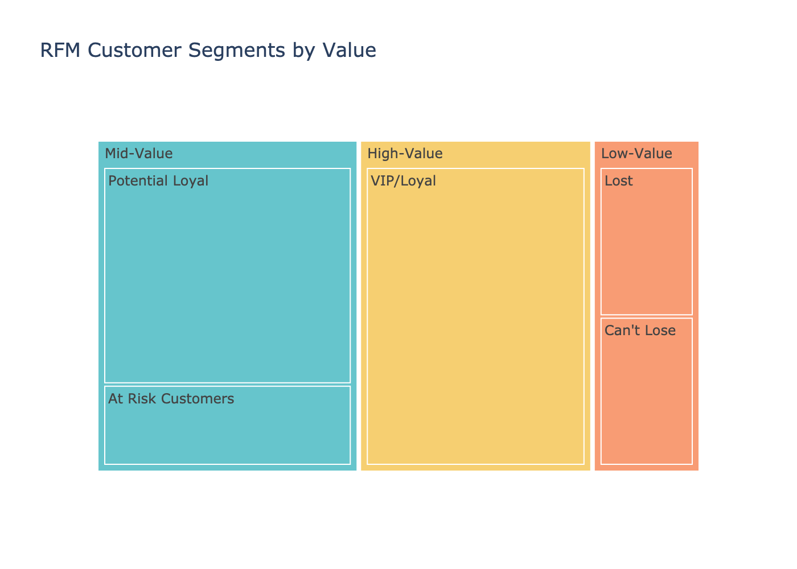
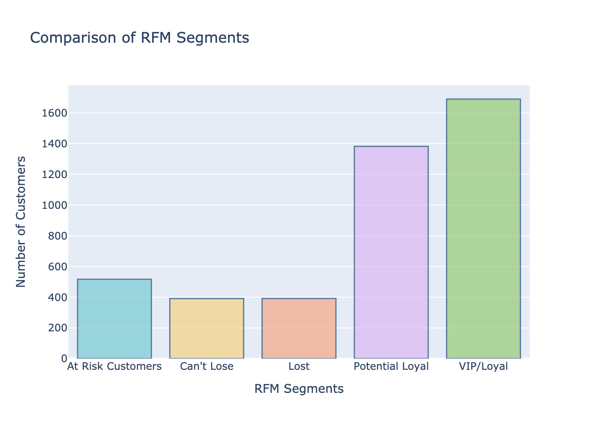
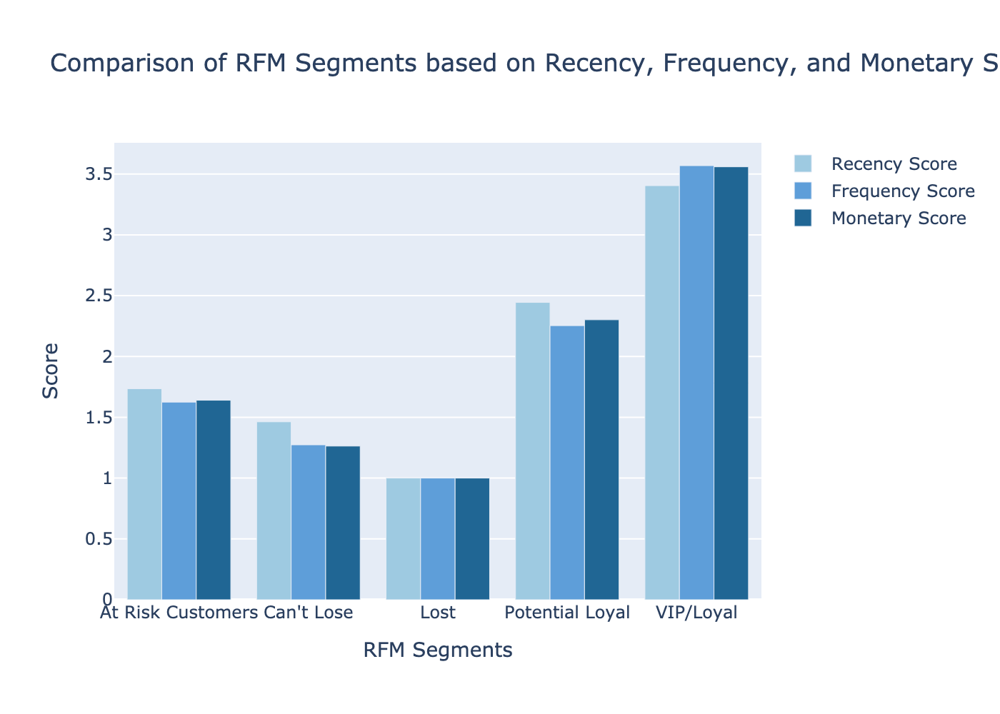
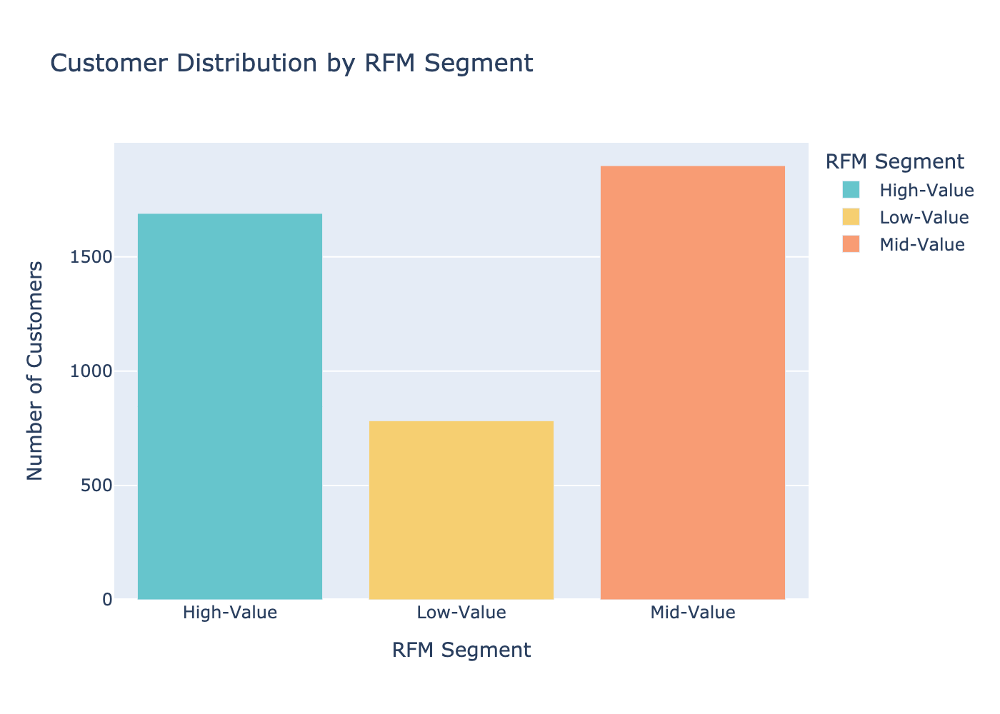

# 🛒 RFM Customer Segmentation (Python Project)

## 📌 Project Overview

This project uses RFM analysis in Python to group online retail customers by how they shop. RFM stands for **Recency** (how recently a customer bought), **Frequency** (how often they buy), and **Monetary value** (how much they spend). Each customer gets a score from 1 to 4 on each measure, and those scores are combined into marketing segments.

The dataset holds 541,909 transaction lines from a UK-based online gift retailer, covering December 2010 to December 2011. After removing rows with no customer ID, the analysis scored **4,372 customers** across 37 countries and sorted them into 3 value tiers and 5 named segments.

## 🎯 Key Features

✅ Data Cleaning: Removed 135,080 transaction lines with no customer ID, leaving 406,829 lines. 
✅ Feature Engineering: Converted invoice dates to datetime format and calculated a total amount for each line. 
✅ Reference Date: Measured recency from one day after the last purchase in the data, so results do not depend on when the notebook runs. 
✅ RFM Calculation: Grouped transactions by customer to calculate Recency, Frequency, and Monetary value. 
✅ Quartile Scoring: Scored each measure from 1 to 4 using the 25th, 50th, and 75th percentiles. 
✅ Value Tiers: Labeled customers Low-Value, Mid-Value, or High-Value based on their total RFM score. 
✅ Named Segments: Assigned 5 segments, from VIP/Loyal to Lost, to guide marketing actions. 
✅ Interactive Charts: Built bar charts, a treemap, a box plot, and a heatmap with Plotly.

## 📷 Visualizations

### Customer Segments by Value Tier

### Number of Customers per Segment

### Average R, F, and M Scores by Segment

### Customers by Value Tier

## 🗂️ Repository Files

| File | Description |
|------|-------------|
| `rfm_customer_segmentation.ipynb` | Jupyter Notebook with the full code, scoring, segments, and charts |
| `rfm_value_distribution.png` | Bar chart of customers by value tier |
| `rfm_segments_treemap.png` | Treemap of segments grouped by value tier |
| `rfm_segment_comparison.png` | Bar chart of customers in each named segment |
| `rfm_scores_by_segment.png` | Average R, F, and M scores for each segment |
| `vip_rfm_boxplot.png` | Box plot of Recency, Frequency, and Value for VIP/Loyal customers |
| `rfm_correlation_heatmap.png` | Correlation of R, F, and M scores within the VIP/Loyal segment |

**Note:** The dataset (`online_retail.csv`, about 48 MB) is not included because it is larger than GitHub's upload limit. To run the notebook, download it from the link under Dataset Source and place it in the same folder as the notebook.

## 🧹 Data Preparation

- Loaded the data with `pd.read_csv()` using a relative file path, so the notebook runs from any computer.
- Dropped rows with a missing `CustomerID`, since RFM needs to know which customer made each purchase.
- Converted `InvoiceDate` to datetime with `pd.to_datetime()`.
- Created a `TotalAmount` column by multiplying `Quantity` by `UnitPrice`.
- Set the reference date to **December 10, 2011**, one day after the last purchase in the data.
- Grouped by customer to calculate:
  - **Recency:** days since the customer's last purchase
  - **Frequency:** number of transaction lines
  - **Value:** total amount spent

## 🛠️ Skills & Tools Applied

- Language and Environment: Python, Jupyter Notebook in Visual Studio Code (Anaconda)
- Libraries: pandas, Plotly Express, Plotly Graph Objects, kaleido
- Analysis Methods: RFM analysis, quartile scoring, rule-based segmentation
- Data Preparation: Missing value handling, date conversion, feature engineering, `groupby` aggregation
- Visualization: Bar charts, treemap, box plot, correlation heatmap
- Debugging: Fixed import and date issues so the notebook runs cleanly from a fresh kernel

## 📈 Business Questions Answered

This project provides insights into:

- Who are the store's most valuable customers?
- How many customers are at risk of leaving or have already stopped buying?
- How much of total revenue comes from the top segment?
- Which marketing action fits each customer group?

## 💡 Key Insights

| Segment | Customers | Share | RFM Score | Median Days Since Last Purchase | Median Spend |
|---|---|---|---|---|---|
| VIP/Loyal | 1,690 | 38.7% | 9 to 12 | 16 | £1,981 |
| Potential Loyal | 1,382 | 31.6% | 6 to 8 | 59 | £558 |
| At Risk Customers | 517 | 11.8% | 5 | 148 | £322 |
| Can't Lose | 391 | 8.9% | 4 | 157 | £216 |
| Lost | 392 | 9.0% | 3 | 265 | £136 |

- **VIP/Loyal customers drove most of the revenue.** This group made up 38.7% of customers but about **84% of total spend**. **Action:** Protect them with loyalty rewards, early access, and personal outreach.
- **Potential Loyal (1,382 customers) is the largest growth opportunity.** They bought recently but less often and for less. **Action:** Use follow-up offers and product recommendations to move them into VIP/Loyal.
- **At Risk and Can't Lose customers (908 combined) are drifting away.** Their median last purchase was about 5 months before the end of the data. **Action:** Send win-back campaigns before they become Lost.
- **Lost customers (392) had not bought in a median of 265 days.** **Action:** Try one low-cost reactivation offer, then focus budget on the segments above.
- By value tier, **1,690** customers were High-Value, **1,899** were Mid-Value, and **783** were Low-Value.
- Within VIP/Loyal, **Frequency and Monetary scores were mildly linked (r = 0.33)**, while Recency had almost no link to either. Buying more often went with spending more, but recent buyers did not always spend more.

*Note: The analysis follows the tutorial's method, which has a few limits. Cancelled orders (8,905 lines with negative quantities) were kept, which lowers some customers' totals. Frequency counts transaction lines rather than separate orders, so one large order counts as many purchases. Segments are based only on the total RFM score, so "Can't Lose" here means a score of 4, not the usual meaning of a formerly high-value customer. All amounts are in British pounds (£), as in the original data.*

## 🚀 Learning Outcomes

Building this project strengthened my skills in:

📌 Working in Visual Studio Code with Jupyter notebooks for the first time 
📌 Cleaning a large real-world transaction dataset 
📌 Building RFM features with `groupby` and custom functions 
📌 Turning scores into segments that guide business decisions 
📌 Creating and exporting interactive Plotly charts 
📌 Debugging code so it runs cleanly from top to bottom

## 🔮 Next Steps

- Remove cancelled orders and count unique invoices for Frequency.
- Define segments from the R, F, and M scores separately, not just their total, so groups like "Can't Lose" match their standard meaning.
- Compare these rule-based segments with K-means clustering on the same RFM values.
- Add a customer lifetime value estimate for each segment.

## 📚 Dataset Source

[Online Retail Dataset](https://www.kaggle.com/datasets/ulrikthygepedersen/online-retail-dataset) by Ulrik Thyge Pedersen on Kaggle, originally from the UCI Machine Learning Repository.

## 🙌 Acknowledgment

This project showed me how three simple measures can turn hundreds of thousands of transactions into clear customer groups. It also taught me that a segment is only useful when it points to a specific action.

## 🔗 Related Link

[LinkedIn Post](https://www.linkedin.com/in/YOUR-POST-LINK)

## 👨‍💻 Author

**Omar Shazley**: Data Analyst | Python, Excel, SQL, and healthcare data analytics

💼 [LinkedIn](https://www.linkedin.com/in/YOUR-PROFILE) 
💻 [GitHub Portfolio](https://github.com/Bromar95) 
📧 Email: [omarshazley@gmail.com](mailto:omarshazley@gmail.com)

✨ If you like this project, don't forget to ⭐ star the repo!
